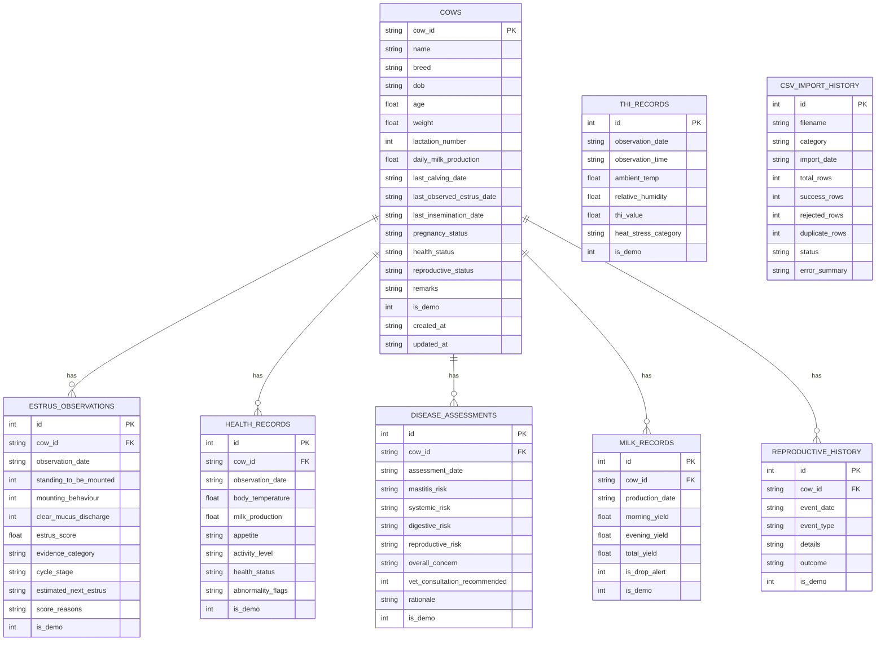

# BoviSense – Intelligent Dairy Cow Management and Monitoring Platform

> **Smart Reproduction. Healthy Herds. Better Dairy Management.**

---

## 📌 Executive Overview

**BoviSense** is an enterprise-grade, web-based dairy cattle management and decision-support system built with **Python**, **Streamlit**, and **SQLite**. Designed for commercial dairy enterprises, herdsmen, agricultural extension specialists, and dairy researchers, BoviSense unites multi-marker estrus detection, health monitoring, preliminary disease risk screening, environmental Temperature-Humidity Index (THI) analytics, milk yield tracking, centralized CSV data processing, and automated PDF reporting into a unified, professional agricultural technology platform.

---

## 🌟 Core Highlights & Architecture

- **Minimalist, High-Cohesion Architecture**: Powered by only two Python source files:
  - `app.py`: Complete Streamlit UI, navigation, interactive Plotly visualizations, transparent decision-support engines, and ReportLab PDF report generation.
  - `database.py`: Persistent SQLite database engine, data integrity constraints, foreign key cascades, transaction management, and synthetic demonstration generator.
- **Persistent Local Database**: Automatically initializes `bovisense.db` with 8 relational tables and performance indexes.
- **Transparent Decision Support**: Rule-based screening scoring (0–100) with clear rationales for estrus and health concerns—no opaque black-box machine learning models.
- **Biometeorological THI Heat-Stress Engine**: True environmental Temperature-Humidity Index tracking with standard dairy threshold categorization.
- **Centralized CSV Import Center**: Ingestion engine covering all 7 operational categories with deep integrity validation, row-by-row error logs, partial imports, and rejected row downloads.
- **Official PDF Report Generator**: Generates styled, publication-ready PDF reports with headers, operational metrics, and veterinary disclaimers powered by ReportLab.
- **Zero Cloud / Paid API Dependencies**: Runs completely locally without third-party subscriptions or specialized hardware.

---

## 🛠️ Technology Stack

| Component | Technology | Version | Purpose |
| :--- | :--- | :--- | :--- |
| **Language** | Python | 3.10+ | Core application logic and data calculations |
| **Web Framework** | Streamlit | ≥ 1.30.0 | Responsive web interface, reactive state management |
| **Database** | SQLite | 3.x | Persistent local database (`bovisense.db`) |
| **Data Processing** | Pandas, NumPy | Latest | Tabular data manipulation and mathematical modeling |
| **Visualizations** | Plotly Express & Graph Objects | ≥ 5.18.0 | Interactive charts, timelines, and distribution plots |
| **Document Generation** | ReportLab | ≥ 4.0.0 | High-quality PDF reports and individual animal dossiers |

---

## 🚀 Quick Start & Installation (Windows)

### 1. Prerequisites
Ensure Python 3.10 or higher is installed and added to your system `PATH`.

### 2. Clone / Open Directory
Open PowerShell or Command Prompt in the project directory:
```powershell
cd "c:\Users\ksdha\OneDrive\Desktop\Final PY"
```

### 3. Install Required Dependencies
Run:
```powershell
pip install -r requirements.txt
```

### 4. Launch BoviSense
Start the Streamlit application:
```powershell
streamlit run app.py
```
The application will automatically launch in your default web browser at `http://localhost:8501`.

---

## 🧭 Navigation & Module Breakdown

The application sidebar provides seamless access to 10 comprehensive modules:

### 1. 📊 Executive Dashboard
- **8 Core Real-Time KPIs**: Total Registered Herd, Active Milking Herd, High Estrus Evidence Candidates, Health Attention Needed, Current Environmental THI & Category, Total Daily Milk Yield, Average Milk/Cow, and Upcoming Estrus Windows (7-day forecast).
- **Interactive Visualizations**: Breed distribution donut chart, reproductive status distribution, estrus evidence classifications, total milk production trends, and environmental THI trajectories.
- **Operational Action Lists**: Immediate health alert list, upcoming estrus candidates, and recent herd events.
- **Demonstration Mode Indicator**: Clear badge distinguishing demonstration records from actual farm measurements.

### 2. 🐄 Cow Management & Herd Registry
- **Comprehensive Cattle Profile**: Unique Cow ID, Name, Breed, Date of Birth, Age (auto-calculated from DOB), Weight (kg), Lactation Number, Daily Milk Yield, Last Calving Date, Last Insemination Date, Pregnancy Status, Health Status, Reproductive Status, and Remarks.
- **Search & Multi-Filter Registry**: Real-time search by Cow ID or Name, with filters for Breed, Reproductive Status, and Health Status.
- **Individual Cow Dossier**: Full 360-degree profile including individual milk production trends, estrus history, clinical health logs, and reproductive event timeline.
- **Record Operations**: Add new cows, edit existing cattle profiles, or safely delete cow records with confirmation and cascading cleanup.

### 3. 🎯 Rule-Based Estrus Prediction & Reproductive Cycle Tracking
- **Transparent Weighted Scoring Algorithm (0–100 Score)**:
  - *Standing to be mounted* (Primary sign): **+35 pts**
  - *Mounting other herdmates* (Secondary sign): **+15 pts**
  - *Clear viscous vaginal mucus discharge*: **+15 pts**
  - *Restlessness / Pacing*: **+10 pts**
  - *Increased walking activity / Pedometry spike*: **+10 pts**
  - *Frequent vocalization / Bellowing*: **+10 pts**
  - *Swollen / Reddened (hyperemic) vulva*: **+10 pts**
  - *Reduced feed intake*: **+8 pts**
  - *Transient milk yield drop*: **+7 pts**
  - *Reproductive Cycle Alignment*: **+10 pts** bonus if 18–24 days since last estrus (~21-day reference window).
- **Evidence Categorization**: Low (0–34), Moderate (35–64), High (65–100).
- **Estrous Cycle Stage Inference**: Automatically classifies cycle stages (*Proestrus, Estrus, Metestrus, Diestrus*).
- **Projected Breeding Window**: Automatically forecasts next estimated estrus date (`Observation Date + 21 days ± 2 days`).
- **Bulk CSV Estrus Screening**: Upload observation spreadsheets to calculate batch estrus evidence scores and download prediction outputs.

### 4. 🩺 Health Monitoring & Abnormality Detection
- **Clinical Parameter Logging**: Record Cow ID, Date, Body Temperature (°C), Daily Milk (L), Appetite State (*Normal, Reduced, Anorexic, Increased*), Feed Intake (kg DM), Water Intake (L), Activity Level (*Normal, Restless, Lethargic, Hyperactive*), General Behaviour (*Normal, Isolated, Agitated, Dull*), Symptoms, and Notes.
- **Automated Abnormality Screening**: Detects fever (> 39.5 °C), mild pyrexia (39.3–39.5 °C), hypothermia (< 38.0 °C), appetite depression, and sensorium depression.
- **Visual Clinical Trajectories**: Interactive scatter plot of herd body temperatures over time with physiological normal threshold bands.

### 5. ⚠️ Preliminary Disease Risk Screening
- **Rule-Based Preliminary Health Screening**:
  1. *Possible Mastitis Screening*: Evaluates quarter swelling, tenderness, abnormal appearance, clotty/watery milk, sudden yield drops (>20%), and elevated body temperature.
  2. *Systemic / Fever Screening*: Identifies high pyrexia and depressed sensory responses.
  3. *Digestive Concern Screening*: Detects severe appetite depression and reported digestive signs.
  4. *Reproductive Health Screening*: Screens for purulent discharges and breeding complications.
- **Overall Concern Level**: Low concern, Moderate concern, High concern.
- **Veterinary Intervention Recommendation**: Displays prominent advisory banner whenever clinical parameters exceed critical thresholds.
- **Transparent Rationale**: Itemized explanation of every contributing clinical factor.
- *Disclaimer: Designed for herd decision support; never a substitute for a licensed veterinary diagnosis.*

### 6. 🌡️ Temperature-Humidity Index (THI) & Heat Stress Analytics
- **Standard Dairy THI Formula**:
  $$\text{THI} = (1.8 \times T + 32) - ((0.55 - 0.0055 \times \text{RH}) \times (1.8 \times T - 26))$$
  *(Where $T$ is ambient environmental temperature in °C and $\text{RH}$ is relative humidity percentage).*
- **Indicative Thermal Stress Categories**:
  - **THI < 68**: Lower concern (Optimal cow comfort).
  - **THI 68–71**: Possible mild heat stress (Respiration rate elevation).
  - **THI 72–79**: Significant heat-stress concern (Drop in feed intake and milk production).
  - **THI ≥ 80**: Severe heat-stress concern (Acute heat exhaustion and severe yield decline).
- **Biometeorological Integrity**: Uses ambient weather only; cow body temperature is never used in the environmental THI formula.
- **Cross-Analysis**: Explores correlation between environmental THI and herd milk yield, detailing how heat stress suppresses behavioral estrus expression (*silent heat*).

### 7. 🥛 Milk Production Management
- **Daily Milking Records**: Log morning and evening milk yields with automatic total daily yield calculation.
- **Production Trends**: Track herd aggregate daily production or filter by individual cow to inspect morning vs. evening yields.
- **Unusual Yield Drop Alerts**: Compares current yields against a 5-day rolling average to flag cows dropping > 25% below baseline.

### 8. 📑 Reports, Statistical Analytics & PDF Generation
- **6 Report Categories**:
  1. Overall Herd Summary Report
  2. Individual Cow Performance Report
  3. Estrus & Reproductive Cycle Report
  4. Health Monitoring & Screening Report
  5. Environmental THI & Heat Stress Report
  6. Milk Production Tracking Report
- **Export Options**:
  - **CSV Spreadsheet**: One-click download of filtered records.
  - **Official ReportLab PDF Document**: Generates structured, styled PDF reports with BoviSense green headers, KPI summary tables, detailed records, and clinical disclaimers.

### 9. 📥 Centralized CSV Import Center
Supports bulk data ingestion for all 7 dairy data categories:
- **A. Cow Registration Registry**
- **B. Estrus Observations**
- **C. Health Monitoring Records**
- **D. Disease Screening Observations**
- **E. Environmental THI Records**
- **F. Milk Production Records**
- **G. Reproductive History Events**

**Features**:
1. Downloadable pre-formatted CSV templates and sample files for every category.
2. File preview showing raw data and row counts.
3. Strict schema validation: required columns, date formats (`YYYY-MM-DD`), and physiological range checks.
4. Unknown Cow ID detection: Alerts users if a cow ID does not exist in the herd registry.
5. Duplicate prevention.
6. Row-by-row error reporting with downloadable rejected-rows CSV containing specific error annotations.
7. Safe database transaction commit with import audit logging.

### 10. 📤 CSV Export & Database Backup Center
- **One-Click CSV Exports**: Download all current tables (`cows`, `estrus`, `health`, `disease`, `thi`, `milk`).
- **SQLite Database Snapshot**: Download binary backup copy of `bovisense.db`.
- **Database Restore**: Upload and restore previous database snapshots.

---

## 💾 Database Architecture

The application persists data in a single SQLite database named `bovisense.db`:



---

## 🧪 Demonstration & Testing Guide

BoviSense includes a built-in **Demonstration Mode**:
1. Click **✨ Load Demonstration Data** in the sidebar.
2. 20 diverse dairy cows across 6 breeds are populated with:
   - 35+ estrus observations spanning multiple cycle stages.
   - 45+ clinical health logs with temperature variations.
   - Disease screening records with clinical mastitis flags.
   - 16 THI biometeorological records spanning all 4 heat stress tiers.
   - 280+ daily milk yield entries showing lactation persistence.
   - Full reproductive event history (calvings, inseminations, pregnancy checks).
3. To reset the database for your farm, simply click **🗑️ Clear Demo Records**.

---

## ⚖️ Disclaimers & Regulatory Notes

- **Decision Support Only**: BoviSense provides indicative herd screening and management support. It does **not** provide clinical veterinary diagnoses or medical prescriptions.
- **Veterinary Examination**: Whenever animals exhibit critical health flags, fever (> 39.5 °C), or severe mastitis symptoms, immediate on-site examination by a licensed veterinary practitioner is strongly advised.

---

## 📄 License & Attribution

Developed for intelligent dairy herd management and scientific decision support.
Copyright © 2026 BoviSense Platform. All rights reserved.
